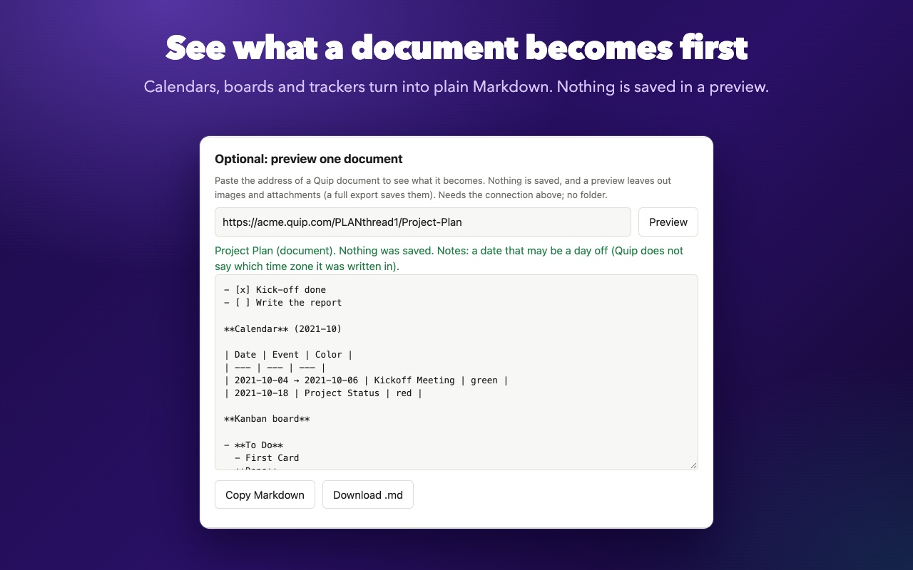
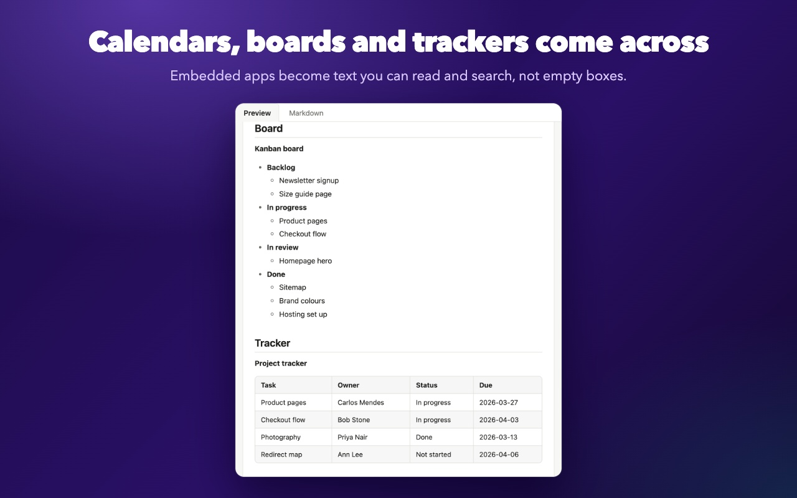
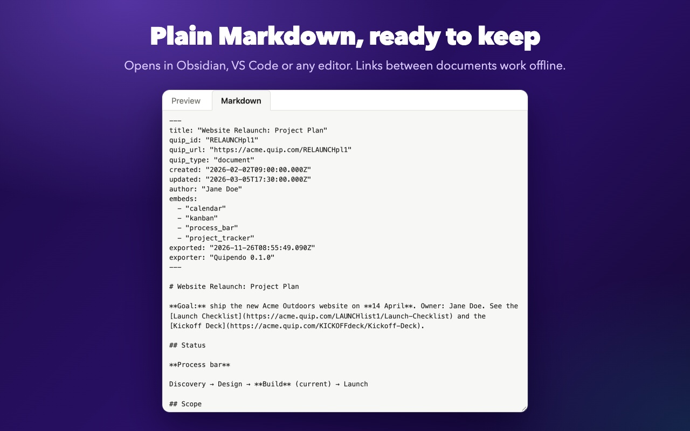
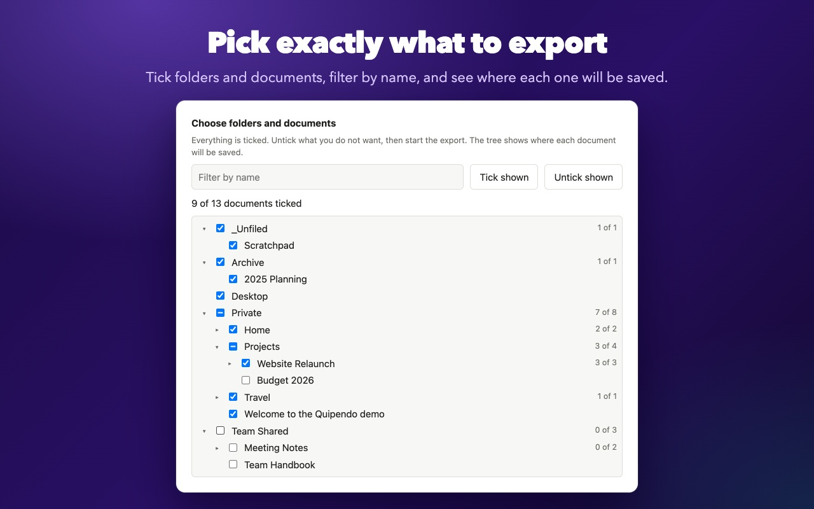

<p align="center">
  
</p>

<h1 align="center">
  <picture>
    <source media="(prefers-color-scheme: dark)" srcset="assets/wordmark-on-dark.svg">
    
  </picture>
</h1>

<p align="center"><em>A charm that turns your Quip folders into Markdown, before Quip goes away.</em></p>

<p align="center">
  <a href="LICENSE"></a>
  <a href="https://github.com/sponsors/aarjav1714"></a>
</p>

**Quipendo** is a browser extension for **Chrome and other Chromium browsers, Firefox and Safari**, and a command line version of the same code, that copy your Quip folders and documents to Markdown, keeping Quip's folder structure, into a folder on your computer (or, from the extension, a `.zip`). It also converts embedded content that other exporters drop: **calendars, Kanban boards, project trackers, process bars, embedded and standalone spreadsheets**, comments (placed next to the text they are about), images and file attachments. You can preview a document first, tick exactly which folders and documents to export, export only what changed since a date, and add Word copies.

**It is read-only.** It cannot create, edit or delete anything in Quip, and it never deletes files from your target folder or overwrites a file it did not create. See [Read-only guarantees](#read-only-guarantees).

Quip is being retired. [Salesforce's notice](https://help.salesforce.com/s/articleView?id=005299603&language=en_US&type=1) says subscriptions cannot be renewed after 1 March 2027 and gives 31 March 2027 as the date after which an instance is no longer accessible; your own deadline is whichever applies to your account. Export while you can still sign in.

## See it first

You do not need a Quip account to see what Quipendo does.

- **Try the demo.** In the extension, press **Try the demo**. It opens a made-up account ("Acme Studio": thirteen documents, five people) inside the page, with no token and no network, so you can preview a document drawn the way it reads (the **Preview** tab) or as the Markdown it will be saved as (the **Markdown** tab), tick folders, and export to a folder or a `.zip` exactly as you would with your own account. Everything in it is invented.
- **Read what comes out.** [`examples/sample-output/`](examples/sample-output) is what Quipendo wrote for that account. GitHub shows the Markdown rendered, so start with [the project plan](examples/sample-output/Private/Projects/Website%20Relaunch/Website%20Relaunch%20-%20Project%20Plan.md): a status bar, a calendar, a Kanban board, a project tracker, images, an attachment and comments, one of them on highlighted text. [examples/README.md](examples/README.md) says where to look for the rest.
- **What it converts.** Calendars, Kanban boards, project trackers, process bars, polls, countdowns, videos, Salesforce records and lists, spreadsheets (the `.xlsx` is kept beside the note, so the formulas survive), checklists, tables, code, quotes, images, attachments, slide decks (a note plus a PDF), comments (next to the text they are about) and links between documents.

<p>
  
  
</p>
<p>
  
  
</p>

## Run it

The extension and the command line are the same exporter, and both only ever send `GET` requests and write the same layout and report. **For the real export use the command line**: nothing has to stay on screen and there is no folder picker. It needs Node 20.19, 22.13 or later and a Quip account that can create an API token (see [Known limits](#known-limits)). The examples write to `~/quip-export`; use a folder of its own (the root and your home folder are refused).

**1. Install**

```bash
git clone https://github.com/aarjav1714/quipendo && cd quipendo
npm ci
```

Once a release is published you can skip this: `npx quipendo --out ~/quip-export` runs the tool with nothing to clone, and the extension is a zip for Chrome and one for Firefox on the [Releases page](https://github.com/aarjav1714/quipendo/releases). The examples below use `npm run cli --`; `npx quipendo` takes the same options.

**2. Get a token.** While signed in to Quip, open `https://<your-site>.quip.com/dev/token` (or `quip.com/dev/token`), click **Get Personal Access Token** and copy it. Give it to your shell without echoing it or leaving it in your history:

```bash
read -rs QUIP_TOKEN && export QUIP_TOKEN    # paste, press Enter; nothing is shown
```

**3. Scan first.** Reads the folder structure and writes nothing:

```bash
npm run cli -- --out ~/quip-export --scan-only
```

```text
Connected as Jane Doe (acme.quip.com).
13 documents in 9 folders would be exported.
1 documents you wrote are in no folder (they go under "_Unfiled").
About 33 Quip API requests. How long that takes depends on the speed Quip allows for your account; it is paced automatically.
Nothing was written.
```

(The examples here are real output, from the made-up demo account described in [See it first](#see-it-first).)

**4. Trial run.** Export one document or folder, then the first few, and open the notes to check them:

```bash
npm run cli -- --out ~/quip-export --from https://<your-site>.quip.com/<id>/Project-Plan
npm run cli -- --out ~/quip-export --limit 5
```

**5. Export everything.** Quip paces its API, so expect roughly ten minutes for every few hundred documents. On a laptop, `caffeinate -i` keeps it from sleeping:

```bash
caffeinate -i npm run cli -- --out ~/quip-export
```

```text
[export] Exporting 13 documents…
[1/13] saved Private/Welcome to the Quipendo demo.md
[2/13] saved Private/Projects/Budget 2026.md
…
Done. 13 saved, 0 unchanged, 0 failed of 13 documents.
Attachments: 6 saved, 0 reused, 0 unavailable. Comments exported: 10.
Embedded content converted: spreadsheet 6, calendar 2, video 2, process_bar 2, kanban 2, project_tracker 1, countdown 2, salesforce_record 1, salesforce_list 1, poll 1.
Warning link-outside-export (1): Team Handbook: OUTSIDEdoc1
1 links point to documents outside this export and still use their Quip address.
Report: _Quip export report.md
```

**6. Check the result.**

```bash
open ~/quip-export/_Quip\ export\ report.md    # "Needs attention" lists warnings and links to documents outside the export
find ~/quip-export -name '*.md' -not -path '*/.quip*' -not -name '_Quip export report.md' | wc -l    # number of notes
```

**7. Run again any time.** Ctrl-C stops safely. The same command continues where it stopped and fetches only what changed in Quip:

```bash
npm run cli -- --out ~/quip-export             # continue, or pick up changes
npm run cli -- --out ~/quip-export --force     # export everything again
```

**8. When finished,** remove the token from your shell and retire it (see [Token handling](#token-handling)):

```bash
unset QUIP_TOKEN
```

**Options** (`npm run cli -- --help`):

```text
--from <url>          one document or folder, with everything inside it
--limit <n>           at most n documents (trial runs)
--since 2025-01-01    only documents changed on or after this date (see "Running it again")
--exclude <url|id>    leave out a folder or a document; repeat for several
--scan-only           read the structure, write nothing
--force               export everything again, even if unchanged
--no-comments         leave out comments and conversation
--no-anchor-comments  list every comment at the end instead of next to its text
--no-raw              do not keep Quip's original HTML (.quip-raw)
--no-xlsx             do not save spreadsheets as .xlsx
--docx                also save Quip's Word copy of each document (one more request each)
--edit-history        experimental: also keep Quip's raw edit records in .quip-raw
--no-unfiled          leave out documents you wrote that are in no folder
--token-stdin         read the token from standard input (pbpaste | npm run cli -- --out ~/quip-export --token-stdin)
--version             show the version
```

For example, to bring an export up to date with only what changed this year, skipping an old folder: `npm run cli -- --out ~/quip-export --since 2026-01-01 --exclude https://<your-site>.quip.com/<id>/Old-Projects`. The token is never printed. Exit status: 0 done, 1 some documents failed, 2 bad arguments or nothing to export, 3 token rejected, 130 stopped.

### Browser extension instead

Same exporter behind a page, in Chrome and other Chromium browsers, Firefox and Safari. Everything below works in all three except where a browser is named.

1. **Get it for your browser.** To build the packages yourself run `npm run build:all`, which writes `dist/` (Chrome and other Chromium browsers), `dist-firefox/` and `dist-safari/`. Once a release is published, [its page](https://github.com/aarjav1714/quipendo/releases) has `quipendo-chrome-<version>.zip` and `quipendo-firefox-<version>.zip`.
   - **Chrome, Edge and other Chromium browsers.** Open `chrome://extensions` (or `edge://extensions`), turn on **Developer mode**, choose **Load unpacked** and pick `dist/` (or the unzipped Chrome package). It uses an API token, not your browser session, so any Chromium browser works. In Dia 1.58 it loaded when Dia was started with `open -a Dia --args --load-extension="$PWD/dist"` (quit Dia first; it lasts for that session; Dia's own *Load unpacked* was not tried).
   - **Firefox 140 or later.** Open `about:debugging#/runtime/this-firefox`, choose **Load Temporary Add-on…** and pick `dist-firefox/manifest.json`. It stays until Firefox restarts; keeping it for good needs a signed add-on ([docs/firefox-addons.md](docs/firefox-addons.md)).
   - **Safari 16.4 or later, on a Mac.** In Safari's Settings → Developer tick *Allow unsigned extensions*, choose **Add Temporary Extension…**, pick `dist-safari/`, then turn it on in Settings → Extensions. It stays until Safari quits. [docs/safari.md](docs/safari.md) has the steps, how to build it with Xcode, and what Safari does differently.
2. Get a token as in step 2 above.
3. Click the extension's toolbar icon (if a Quip page is open you can export just that document or folder), paste the token and press **Connect**. Firefox and Safari may ask you to let Quipendo use `platform.quip.com`: allow it. If the browser has not given the access, the page says so and where to change it.
4. *Optional:* paste a document's address under *preview one document* to see what it becomes. Nothing is saved and images and attachments are left out; **Copy Markdown** or **Download .md** takes the text.
5. **Choose where to save.**
   - A **folder** on your computer, in Chromium browsers (they are the only ones that let a page write into a folder you pick). Best for a large account: it can be stopped, continued and updated later, and nothing is held in the browser.
   - **Kept in the browser**, then saved as a **.zip** when you want it: the only choice in Firefox and Safari, and available in Chromium browsers too. The copy lives in the browser's own storage, so it survives closing the tab or the browser, and works like a folder: you can stop at any time, continue later, and skip what has not changed. **Clear stored copy** removes it (it asks first). A very large export is saved as several `.zip` files of at most 1 GiB or 50,000 files each, which unzip into the same folder.
6. Choose the folders and options and press **Scan** (nothing is written yet). Untick what you do not want in the tree that appears (a folder takes its contents along, and the filter box narrows the list), then **Start export**. For a first run tick *Limit to the first N documents* and try 5. *Only documents changed since* leaves older ones out.
7. When it finishes, press **Save as .zip** if you kept the export in the browser. If the browser runs out of room the export stops, says so, and what is already stored can still be saved; clear it and carry on with the rest.

**Keep the exporter tab on screen while it runs.** Browsers throttle and may freeze pages that are not visible. In Dia, an exporter tab whose window was not on screen (covered, minimized or on another desktop) made a request every 30 to 60 seconds and once paused for more than two minutes, while the command line version, which has no tab to throttle, averaged about two requests a second. Keep the exporter tab selected in a window you can see, or use the command line above, which does not depend on a tab.

## What you get

```text
<target folder>/
  Private/                      Quip folder tree, one directory per folder (empty folders too)
    Projects/Project Plan.md    one note per document
    Projects/Budget.md          a note with a spreadsheet gets the original next to it…
    Projects/Budget.xlsx        …as .xlsx, the only way to keep formulas (optional)
    Projects/Project Plan.docx  Quip's own Word copy of a document (optional, --docx)
  Team Shared/…
  _Unfiled/                     documents you wrote that are in no folder of your account
  _attachments/<thread id>/…    images and files, linked with relative paths
  _Index.md, _index.json        a table of contents of everything exported: for reading, and for programs
  .quip-raw/<thread id>/        Quip's original HTML, metadata and messages (optional)
  .quip-md-export/              resume state and a machine-readable report
  _Quip export report.md        what was exported, and what needs attention
```

Each note starts with YAML front matter and uses relative Markdown links, so it opens cleanly in Obsidian or any editor:

- `title`, `quip_id`, `quip_url`, `quip_type`, `created`, `updated`, `author`, `exported`, `exporter`
- `folder`, plus `also_in` for other folders that contain the same document. Quip folders behave like tags, so a document in several folders is written once, under the first folder in the order you export them.
- `embeds`: the kinds of embedded content found (`calendar`, `kanban`, `project_tracker`, `spreadsheet`, …)
- `moved_to`: set when Quip says the document was already moved elsewhere (for example to Slack)

Links between exported documents are rewritten to relative links. Links to documents outside the export keep their Quip URL and are listed in the report, since they stop working when Quip does.

**Running it again** is safe and incremental:

- A note this tool wrote is updated in place when the document changed in Quip, when a note it links to appeared, moved or was renamed (so its relative links stay right), when an attachment, `.xlsx` or raw file it links to or archives was deleted, or when you changed the options that affect its content. If nothing changed in Quip, nothing is written, whatever you did to the file.
- **What you changed is yours.** The tool remembers what it wrote (a fingerprint of each note, `.xlsx` and PDF). If you edited or replaced one and Quip later changes that document, your file is left exactly as it is and the new version is written beside it under a numbered name such as `Notes (3).md`; the report lists it. From then on the numbered copy is the one that gets updated.
- A file this tool did *not* write is never overwritten. That is checked on every run, for every note, and once more right before each write: if something else is now where a note used to be, or appears there while the export runs, the note takes a numbered name instead. A note is recognised as the tool's own by the front matter at its top (`quip_id`), not by a line somewhere in its text; a report that is not the tool's own stays untouched and the new one is written as `_Quip export report (2).md`. Inside its own `.quip-raw` and `.quip-md-export` folders the tool replaces files freely; they are its working area. The names `_attachments`, `_Unfiled`, `_Index.md`, `_index.json` and `_Quip export report.md` are reserved, and the index files follow the same rule as the report: one that is not the tool's own stays untouched and the new one gets a numbered name. If a file appears at a note's name while an export is running, notes written earlier that link to that name are corrected on the next run.
- **Partial runs stay consistent.** `--since`, `--exclude`, `--limit` and unticked documents only decide what is fetched this time. A link to a document exported earlier stays a relative link, one to a document that was never exported keeps its Quip address, and `_Index.md` and `_index.json` are rewritten at the end of every run from everything exported so far, so they always describe the whole export. A folder you exclude drops only the documents that are in no other exported folder (Quip folders behave like tags).
- A document renamed or moved in Quip gets a new file; the old copy stays where it was (nothing is deleted) and is listed in the report. The same happens when its old file name was taken, edited or replaced.
- Only one exporter tab can write at a time (a browser lock): a second tab asks you to wait, so two tabs can never choose the same name for different documents. A tab that scanned before another tab exported plans again when you press Start, so it never works from an out-of-date picture.
- Attachments and spreadsheets Quip refuses (HTTP 403 or 404) are listed in the report and not asked for again on every run; network errors and server errors are retried automatically. Untick *Skip unchanged* to try everything again.
- *Keep Quip's original HTML* (`.quip-raw`): turning it off does not re-export anything and turning it on does; if you delete the folder while the option is on, those documents are fetched again, so untick the option first if you want the space back.
- "Unfiled" means documents you wrote that are in no folder anywhere in your account (Starred is a view, not a folder, so a document that is only starred counts as unfiled; Trash does count as a folder, so deleted documents are left out). Documents other people wrote that are in none of your folders are counted in the scan but not exported. If a folder cannot be read, what is inside it is unknown, so a document you wrote there can appear under `_Unfiled`; the scan summary says so before anything is written (untick the option to leave them out), and the report lists the folders.

## What is converted

- Headings, paragraphs, bold/italic/strikethrough/underline, code blocks, quotes, rules, links, images, file attachments
- Bullet, numbered (with continued numbering) and check lists, nested to any depth
- Tables and spreadsheets (merged cells expanded, Quip's column letters and row numbers removed, one table per sheet). Quip's HTML carries only the displayed values, so the note also links a `.xlsx` export of the same spreadsheet with its formulas (untick *Also save spreadsheets as .xlsx* to skip it)
- **Calendar**: a Date/Event table sorted by date, with ranges and colours
- **Kanban board**: columns as a nested list
- **Project tracker**: a table with people, status labels and dates resolved to readable values
- **Process bar**: the step sequence with the current step marked
- Comments and conversation, with authors, timestamps, mentions and attachments. A comment on highlighted text goes next to that text as a footnote (`highlighted words[^c1]`), replies included; comments that are not on text, or whose text is gone, are listed under *Comments and conversation* at the end (`--no-anchor-comments` lists all of them there)
- Slide decks: a stub note plus a PDF copy (Quip offers no other slide export)
- Any other live app: Quip's own table rendering if present, otherwise the raw payload as JSON, plus a `unknown-live-app` warning naming the app so a converter can be added

Optional extras: the original `.xlsx` of each spreadsheet (on by default) and Quip's Word copy of each document (`--docx`, which leaves comments out because Quip's export does).

Not exported: chats, and live Salesforce data (a placeholder with the record ids is written).

## Read-only guarantees

1. **The client can only read.** Every request is a `GET` without a body, sent only to an allow-list of read endpoints; identifiers are validated so they cannot smuggle in another path (`src/core/quipClient.ts`). JSON endpoints never follow a redirect. A file download may be redirected by Quip and the browser follows it (a browser cannot inspect a redirect before following it); that hop is also a `GET`, must be HTTPS, and the page's policy below only lets it reach Quip's API host. A response that is not the kind of file that was asked for (a `.xlsx` that is not a workbook, a PDF that is not a PDF) is reported as a failure instead of being saved; a JSON attachment shaped like a Quip error report is kept, and flagged `attachment-suspect`.
2. **The browser enforces it too, in Chrome and Firefox.** The extension registers a `declarativeNetRequest` rule that blocks every `POST`, `PUT`, `PATCH`, `DELETE` and other non-read request that the extension itself sends to *any* address, so even a future bug could not modify a document. The page shows "Browser-level read-only guard: on". **Safari cannot offer this**: it accepts such a rule but never applies it to an extension's own requests (on Safari 27 a rule that blocked every request to a server let all of them through), so the Safari build does not ask for the permission, and the page says the guard is unavailable and why. In Safari the other layers are what protect you: the client that can only send `GET`, the policy below, and the tests.
3. **The pages cannot be steered by document content.** The extension pages run under a strict Content Security Policy: scripts, styles and images only from the extension itself, no frames, no forms, and network access only to `https://platform.quip.com`. Quip HTML is parsed into an inert document and only its text and attributes are read; it is never inserted into the page.
4. **Tests prove it.** The mock Quip server records every request and the tests require zero non-GET requests. The same real-browser scenarios run in Chromium, Firefox and Safari. They show that, in Chrome and Firefox, writes (`POST`, `PUT`, `PATCH`, `DELETE`) are blocked before they leave the browser, even to an address the extension has no permission for, and that in every browser documents full of images, frames, scripts, stylesheets and other tags that normally make a browser fetch something cause no request at all. Static checks forbid any other HTTP method, body, `XMLHttpRequest`, WebSocket or file deletion in shipped code, and `npm run verify-build` checks the bundle for test hooks, `eval` and unexpected hosts, and the manifest for extra permissions and a weakened policy.

Permissions requested: `storage` (settings and the stored export), `activeTab` (to offer the page you were viewing), `declarativeNetRequest` (the guard; the Safari build leaves it out) and access to `https://platform.quip.com/*` only. Firefox and Safari ask you to allow that access, which Chrome grants at install. No content scripts, no analytics, nothing is sent anywhere except to Quip. In Firefox the add-on declares that it collects no data. [Chrome describes](https://developer.chrome.com/docs/extensions/reference/permissions-list) `declarativeNetRequest` to the user as "Block content on any page"; the extension uses it only to block its own write requests. The narrower `declarativeNetRequestWithHostAccess` was tried first, but it only covers hosts the extension has permission for, so it could not make the "any address" promise.

## Rate limits and time

Quip rate-limits the API and reports what is left in the headers of every response. On the account this was tested with, the limits were **200 requests a minute per user and 600 a minute per company**, in windows that reset on the minute (older Quip documentation says 50 a minute and 750 an hour, so your account may differ). The exporter reads those headers on every response and spreads the requests that are left over the time that is left, so it uses what the account allows without exceeding it; a pool with none left blocks until its reset, and a 429 or 503 is waited out as the server asks. Quip also sends a `Retry-After` on every *successful* response (it is the time until the window resets), and the exporter correctly ignores it there; an early version treated it as "stop" and spent about a minute per request.

A document needs about 2 requests (content and comments), plus one per attachment, one for a spreadsheet's `.xlsx`, and one more for each optional Word copy or edit history. The tested account (418 documents in 88 folders, 82 spreadsheets, 215 attachments) took about 850 requests and **10 minutes** for the whole export, with no rate-limit pauses. Unchanged documents are skipped on later runs. A request that does not start answering within two minutes is abandoned and retried.

## Token handling

The token is kept in browser session storage and disappears when the browser closes (Safari before 16.4 has none, so there it lives only in the page and disappears sooner). Tick *Remember* to also keep it in the extension's local storage (unencrypted, inside your browser profile); unticking it removes the stored copy immediately. **Forget token** wipes it from the page and from both kinds of storage at once and disconnects. If Quip rejects the token during an export, the export stops, nothing further is attempted, and the report says how many documents were left. The `/dev/token` page only has a "Get Personal Access Token" button (no revoke button); according to [ClonePartner's guide](https://clonepartner.com/blog/how-to-export-data-from-quip-methods-api-limits-migration-prep), generating another token invalidates the previous one, which is the way to retire a token you are finished with. What is stored and what is sent is spelled out in [PRIVACY.md](PRIVACY.md).

## Known limits

- **Tested against one real account.** All 418 documents of a personal account exported with no failures, and every relative link and image in the result resolves. A comparison of the words in each document's original HTML with its note found no lost text apart from live-app markup that has since been handled. Quip's HTML varies by content, so other accounts may contain things this has not seen (the report lists unknown embedded apps as `unknown-live-app`, and the original HTML is kept in `.quip-raw/` so conversion can be improved). Start with a small trial.
- Quip's API is [licensed per plan](https://quip.com/dev/automation/documentation/current#section/License-Requirements): Quip for Customer 360, Quip Plus, Quip Advanced, and Lightning Experience in the Enterprise, Professional, Performance, Unlimited or Developer editions. If your account cannot create a token, this tool cannot read it.
- **Dedicated Quip sites are not supported.** Quip's documentation says customers on dedicated (VPC) sites use `customername.onquip.com` or `quip-customername.com` instead of `platform.quip.com`. Quipendo is tied to `platform.quip.com` throughout (the extension's permission and policy, the request allow-list and the address parser), so only accounts served from quip.com work.
- **Comments next to their text** rely on matching a comment's id to the id in the document's HTML. That follows Quip's API description and the markup of a real export, but it has been tested against the mock server, not yet against a live account with comments on highlighted text. Where the ids do not match, the comment is listed at the end instead, so nothing is lost, and the ids are kept in `.quip-raw/<id>/messages.json`.
- **Edit history** (`--edit-history`) is experimental: Quip's edit records are saved as raw JSON in `.quip-raw/<id>/edits.json`. What they contain has not been checked against a live account, and nothing converts them yet.
- A document can be reached through several Quip addresses. Links are matched by the document id, its current share address and the address Quip reports as its link; a link that uses any other one (for example a previous, replaced share address) stays a Quip URL and is listed in the report.
- If Quip ever serves an attachment from a host other than `platform.quip.com` (its API documents a direct response), the page's policy blocks the download and the attachment is listed as failed in the report. Widen `connect-src` in `extension/manifest.json` if that happens.
- Project tracker dates are stored by Quip as timestamps and are shown as the calendar day in your browser's time zone. When the stored instant is neither midnight in that zone nor UTC midnight, the day is a best guess (it can be one day off for an author far from your time zone) and the report lists it as `ambiguous-date`. Documents with a project tracker are exported again if your browser's time zone changes.
- Comments are fetched newest first by timestamp. If a whole page of comments shares one microsecond timestamp, Quip offers no way to page past it, so the report warns `comments-incomplete`; this is not expected in practice.
- Quip's `updated_usec` decides whether a document changed; documents whose live-app content changes without bumping it are not re-exported unless you untick *Skip unchanged*.
- Browsers throttle timers in background tabs; waiting out a rate limit may be a little late but is never early.
- **Firefox and Safari cannot write into a folder you choose**, so the extension keeps the export in the browser's own storage and saves it as `.zip` files. That copy stays on your computer, inside the browser profile and unencrypted, until you clear it or uninstall the extension, and it takes space the browser may limit; for a large account use the command line, or a Chromium browser with a folder.
- **Safari**: macOS only, Safari 16.4 or later (the iPhone and iPad are not covered), and tested on Safari 27 only. There is no browser-level guard (see above). Safari asks you to allow each site, and, depending on its *File download location* setting, where to save each `.zip`. A developer build needs *Allow unsigned extensions* again after every launch of Safari; an extension other people can install needs Apple's paid developer program ([docs/safari.md](docs/safari.md)).
- **Firefox**: needs 140 or later, and was tested on stock Firefox 160 and 161. The add-on id (`quipendo@aarjav1714.github.io`) is fixed on the first submission to addons.mozilla.org ([docs/firefox-addons.md](docs/firefox-addons.md)).

## Support

If Quipendo saved your Quip documents, you can [sponsor it on GitHub](https://github.com/sponsors/aarjav1714), once or monthly. Reports of Quip content that did not convert well help just as much: a small snippet from `.quip-raw/` with anything private removed is enough to add a converter.

## Prior art

None of these is a browser extension that mirrors a whole Quip folder tree as Markdown:

- [Quip Export Tool](https://chromewebstore.google.com/detail/quip-export-tool/fjmpkbfjmkgmkcnkhmjdceijecldojjl) is a Chrome extension with a folder browser that downloads folders as Word and Excel files, not Markdown.
- [Minibase Web Clipper](https://chromewebstore.google.com/detail/minibase-web-clipper/mamnlljnkigkhppbjhmpdeocobcbobdp) is a Chrome extension but converts one page at a time (free tier of 3 saves a month, closed source). Its [Quip guide](https://www.minibase.md/blog/quip-export-to-markdown-guide/) says live apps are rendered only as links.
- [sonnenkern/quip-export](https://github.com/sonnenkern/quip-export) (MIT, archived August 2026) exports the whole account through the API as HTML or DOCX.
- [hcdierks/quip-export](https://github.com/hcdierks/quip-export) (Markdown, DOCX and PDF) and [naveen/quip-export](https://github.com/naveen/quip-export) (Markdown with front matter and an `_index.json`) are two of the command line tools that appeared in 2026.
- [jmoraispk/quip-export](https://github.com/jmoraispk/quip-export) drives the Quip UI with Playwright to produce HTML, then converts with Pandoc.
- [swestwood/quiport-import](https://github.com/swestwood/quiport-import) builds a browsable HTML archive and documents how Quip's HTML represents live apps (`data-live-app-payload` and a server-rendered `<details>` table), which informed this converter. No code was copied from any of these projects.

## Development

```bash
npm test               # unit and mock-server integration tests
npm run e2e            # builds a test variant and drives it in a real Chromium with Playwright
npm run e2e:firefox    # the same scenarios in stock Firefox, through geckodriver
npm run e2e:webkit     # the page itself in WebKit, Safari's engine, with the extension API stood in for (no Mac needed)
npm run e2e:safari     # the same scenarios in the real Safari on a Mac, through AppleScript (one-time setup: docs/safari.md)
npm run build:all      # dist/ (Chrome), dist-firefox/ and dist-safari/
npm run smoke          # opens the package people install (minified, no test hooks) in Chromium; smoke:firefox and smoke:webkit do the same
npm run check          # typecheck, tests, production builds for all three browsers, build verification
npm run icons          # redraws the PNG icons, the store icon, assets/logo-512.png and the social preview from assets/logo.svg
npm run store-assets   # remakes the Chrome Web Store tiles and screenshots in assets/store/
```

The PNGs are committed, so a normal build needs neither `npm run icons` nor a browser. The social preview (`assets/social-preview.png`) is uploaded by hand in the repository settings.

The artwork has two sources. `assets/logo.svg` is the logo: a Q that is also a smiling fish (the ring is the body, the Q's tail is the tail fin). `assets/wordmark-on-dark.svg` and `assets/wordmark-on-light.svg` draw the name as **QuipEnd!**, with the heavy dot of the exclamation mark standing in for the *o* of Quipendo; the letters are outlines of [Figtree](https://github.com/erikdkennedy/figtree) Black (SIL Open Font License 1.1), so nothing depends on an installed font. The name is still written *Quipendo* everywhere it is text (the package, the command, the store listing).

- `src/core/` has no browser dependencies: `convert/` (HTML → Markdown), `quipClient.ts`, `exporter.ts`, `naming.ts`, `rewrite.ts`, `indexFiles.ts` (the index files) and `zip.ts` (the `.zip` output).
- `src/ui/` is the exporter page (File System Access API, settings, progress, the folder tree in `tree.ts`, the export kept in the browser in `storeSink.ts`, and `webext.ts` and `guard.ts` for what differs between browsers); `src/background.ts` and `src/openExporter.ts` open it. `scripts/targets.mjs` says how each browser's manifest differs.
- `src/node/` is the command line version (`cli.ts`, a Node file sink and a jsdom parser); `npm run build:cli` writes `dist-cli/cli.mjs`.
- `tests/mock/` is a synthetic Quip API (users, folders, paginated HTML, messages, blobs, 503 throttling, failure injection) used by both the integration and browser tests, which require the browser export to match the Node export file for file.
- `tests/e2e/browser.e2e.test.ts` holds the scenarios once; `tests/e2e/harness/` has a driver for each browser (`E2E_BROWSER=chromium|firefox|webkit|safari`). A scenario a browser cannot run, such as the folder picker in Firefox, is skipped for it, with the reason in its name.

To add support for another embedded type, extend `src/core/convert/liveApps.ts` and add a case to `tests/unit/liveApps.test.ts`.

**Releasing.** Push a tag `vX.Y.Z` that matches the version in `package.json`, `extension/manifest.json` and `TOOL_VERSION` in `src/core/exporter.ts` (`npm run verify-build` fails if they differ). The [Release workflow](.github/workflows/release.yml) runs the checks, the browser tests in Chromium, Firefox and WebKit and the Firefox lint, attaches `quipendo-chrome-vX.Y.Z.zip`, `quipendo-firefox-vX.Y.Z.zip`, `quipendo-safari-vX.Y.Z.zip` (what App Store Connect's Safari packager takes), the source (`quipendo-source-vX.Y.Z.zip`, which addons.mozilla.org asks for because the code is bundled) and checksums to a GitHub release, and publishes the command line tool to npm when an `NPM_TOKEN` secret exists. The [CI workflow](.github/workflows/ci.yml) runs the same checks on every push, plus the page in WebKit, a Safari package build on macOS and the packed tool on Node 20, 22 and 24. Publishing is described for the [Chrome Web Store](docs/chrome-web-store.md), [Firefox](docs/firefox-addons.md) and [Safari](docs/safari.md), with [docs/publishing.md](docs/publishing.md) as the place to start; [docs/reviewing.md](docs/reviewing.md) is for store reviewers, who have no Quip account, and has the text to paste into each store's reviewer notes.

## License

[MIT](LICENSE)

Quipendo is an independent project. It is not affiliated with, endorsed by or sponsored by Salesforce. Quip is a trademark of Salesforce, Inc.
