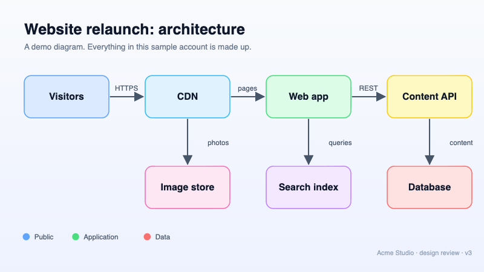
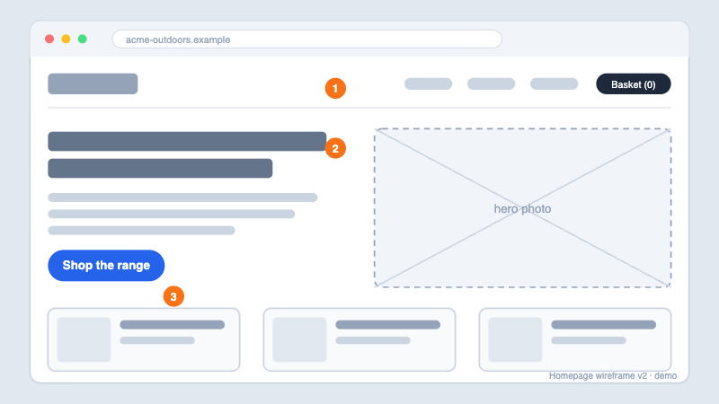

# Website Relaunch: Project Plan

**Goal:** ship the new Acme Outdoors website on **14 April**. Owner: Jane Doe. See the [Launch Checklist](Launch%20Checklist.md) and the [Kickoff Deck](Kickoff%20Deck.md).

## Status

**Process bar**

Discovery → Design → **Build** (current) → Launch

## Scope

- [x] Audit the current site
- [x] Agree the sitemap
- [ ] Build the product pages[^c1]
- [ ] Migrate 120 blog posts
- [ ] Set up 301 redirects

## Timeline

**Calendar** (2026-04)

| Date | Event | Color |
| --- | --- | --- |
| 2026-03-02 | Kickoff | blue |
| 2026-03-16 → 2026-03-18 | Design review | green |
| 2026-03-27 | Content freeze | orange |
| 2026-04-07 → 2026-04-09 | Soft launch to staff | purple |
| 2026-04-14 | Launch day | red |

## Board

**Kanban board**

- **Backlog**
  - Newsletter signup
  - Size guide page
- **In progress**
  - Product pages
  - Checkout flow
- **In review**
  - Homepage hero
- **Done**
  - Sitemap
  - Brand colours
  - Hosting set up

## Tracker

**Project tracker**

| Task | Owner | Status | Due |
| --- | --- | --- | --- |
| Product pages | Carlos Mendes | In progress | 2026-03-27 |
| Checkout flow | Bob Stone | In progress | 2026-04-03 |
| Photography | Priya Nair | Done | 2026-03-13 |
| Redirect map | Ann Lee | Not started | 2026-04-06 |

## Design

The design brief is attached: [design-brief.pdf](../../../_attachments/RELAUNCHpl1/design-brief.pdf).

*Architecture, version 3*

*Homepage wireframe, version 2*

## Comments and conversation

> **Ann Lee** · 2026-02-10 10:12 UTC
> Can we move the content freeze to the 27th? The photographer is away until the 24th.

> **Jane Doe** · 2026-02-10 10:40 UTC
> Yes, done. @Carlos Mendes please update the calendar.

> **Bob Stone** · 2026-02-11 09:05 UTC
> Design brief attached, version 3.
> 📎 [design-brief.pdf](../../../_attachments/RELAUNCHpl1/design-brief.pdf)

[^c1]: **Ann Lee** · 2026-02-12 14:20 UTC

    Do the old product URLs need to keep working?

    **Jane Doe** · 2026-02-12 15:02 UTC

    Yes: 301 redirects for everything under /shop. The map is attached.
    📎 [redirect-map.pdf](../../../_attachments/RELAUNCHpl1/redirect-map.pdf)
